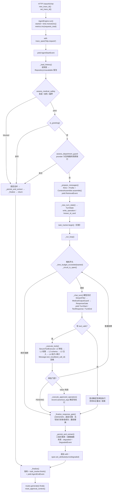

# 主体 Agent 整改 · B0 行为基线冻结

> **依据**：`docs/主体Agent生产化架构最终整改方案.md`（2026-11-12，审计基线 `ab9b8f3`）
> **冻结提交**：`94997d03753450bbb28d9eda84a29258d4ca7ece`（远程 `main`，方案文档合入后）
> **冻结时间**：2026-11-12
> **文档性质**：Phase 0 / 批次 B0 交付物。**本批次不改动任何生产行为**，只把现有行为、状态与验收口径钉死，供 B1–B9 复用同一份清单回归。
> **与旧文档的关系**：`docs/python-production-baseline.md` 是旧审计体系（P0-01…P1-07）的历史冻结快照，正文按历史保留、不改写；本文是新一轮主体 Agent 架构整改的独立基线。

---

## 1. 可重复执行的基线

### 1.1 运行环境与命令

| 项 | 值 |
|---|---|
| 工作目录 | `guiguXiaozhi_backend_py/` |
| 解释器 | `.venv/bin/python` → Python **3.11.18** |
| 测试框架 | pytest **8.3.4**（`pytest.ini`：`asyncio_mode = auto`，`testpaths = tests`） |
| 基线命令 | `./.venv/bin/python -m pytest tests/ -q -ra` |
| 依赖 | `requirements.txt`（pytest==8.3.4 / pytest-asyncio==0.25.0） |
| 操作系统 | macOS (darwin) |

> 注意：仓库里同时存在 `venv/`（Python 3.9，**未装 pytest**）与 `.venv/`（Python 3.11，可用）。
> 基线命令必须用 `.venv/bin/python`，用 `venv/bin/python` 会报 `No module named pytest`。

### 1.2 基线结果（本次实跑）

```
876 passed, 6 skipped, 1 warning in 30.60s
EXIT=0
```

| 项 | 数量 | 说明 |
|---|---:|---|
| 单测文件 | 53 | `tests/unit/` 等，全部通过 |
| 集成测试文件 | 2 | `tests/integration/`，共 6 条用例 |
| passed | **876** | 与 `python-production-baseline.md` 第 18.9 节记录的 876 一致 |
| skipped | **6** | `tests/integration/test_live_api.py` |
| warning | 1 | `starlette/testclient.py:40` 的 `anyio.abc.BlockingPortal` DeprecationWarning（第三方库，非本仓库代码） |

**6 条 skip 的原因（逐条可核对）**：`tests/integration/test_live_api.py` 带 `pytestmark = pytest.mark.integration`；`tests/integration/conftest.py` 的 `live_client` 夹具在未加 `--run-integration` 时不启用，`/health` 探测不到服务即整体 `pytest.skip`。这些用例**会真的调用本地 7B 模型**（单条 25–60s），并需要 Ollama / Milvus / MySQL / MongoDB 与已运行的后端。

启用方式（不计入离线基线，属真机验收）：

```
XIAOZHI_PY_BASE_URL=http://127.0.0.1:8082 \
  ./.venv/bin/python -m pytest tests/integration -q --run-integration
```

### 1.3 每批次统一回归口径

B1–B9 每一批交付时，至少执行并如实记录：

1. `./.venv/bin/python -m pytest tests/ -q -ra` → **passed 数不得低于 876，skip 数保持 6，EXIT=0**；新增用例只允许增加 passed。
2. `ruff check xiaozhi tests --select E9,F63,F7,F82,F811`（既有 CI 门禁口径）。
3. 本批次新增行为的定点用例（写在各自交付清单里）。
4. 若改动涉及流式输出 / 审批 / HIS，另跑对应 `scripts/*.py` 真机演练；真机结果由用户本地复验，不由代码修改者代签。

> 方案第 6 节纪律：**用户本地回归通过并合并到远程 `main` 后，才推进下一批**。若回归发现行为差异，先修当前批次，不叠加后续结构性改动。

---

## 2. 端到端状态图（当前真实实现）



### 2.1 图中必须记住的四个结构性事实

1. **`run()` 全文没有 `try / except / finally`**（`engine.py:102-277`）。唯一的 `try` 是科室名单取值 `engine.py:180-189`；`finally` 只在 `server/routes.py:261-262` 的 `reset_approval_context()`。
2. **收尾有两个位置**：三条确定性短路（医疗安全 / 问候 / 科室守卫）各自在分支内部调用 `_finalize` 后 `return`（例：`engine_phases.py:168-215` 的 `_short_circuit_greeting`）；正常路径的 `_finalize` 在 `with` 之后（`engine.py:270-277`）。
3. **`_finalize` 是顺序代码，异常会跳过它** → 任务不终态化、`AgentEndEvent` 丢失。`Span.__exit__` 虽会 `set_error` 并清空 `_current_span_var`（`reliability/tracing.py:146-156`），但 `_trace_id_var` 从不 reset。
4. **短路分支不发 Turn 事件，但发 `AgentEndEvent`**；事件顺序兼容性是 B2 拆 mixin 时的硬约束。

### 2.2 时间预算与计数（唯一事实来源盘点）

| 项 | 位置 | 语义 |
|---|---|---|
| `started = time.monotonic()` | `engine.py:126` | **全 Run 唯一基准**，传给 `_run_loop` / `_finalize` / 短路分支 |
| `request_timeout` | `config.py:157`（默认 300.0 秒）→ `engine.py:67` → `application.py:749` | 总预算 |
| `_time_budget_exceeded(started)` | `engine_phases.py:871-876` | `time.monotonic() - started > request_timeout`；**只在 `_run_loop` 每轮开头判一次**（`:1207`），不按阶段重计时 |
| `state.tool_call_count` | `state.py:41`，判定 `:700` / 自增 `:712` | 上限 `max_tool_calls`（默认 8） |
| `state.corrective_used` | `state.py:54`，`schedule/consume_corrective :196-227` | 不变量 I1：每请求 ≤ 1 次纠正重试 |
| `state.approval_forced_retry_done` | `state.py:70` | 独立闸门，不复用 `corrective_used`（否则计数永远 0 → 无限重试） |

> 结论：**当前并不存在「每个阶段重新计时」的问题**，缺的是把这些量收敛进一个请求级对象，以及取消 / 异常时的统一收尾。

---

## 3. 行为表（10 条端到端流程）

「回归锚点」列是 B0 之后每个批次都要复跑的既有测试文件。

| # | 流程 | 当前实现与状态 | 回归锚点 | 已知缺口 |
|---|---|---|---|---|
| B1 | 正常问答 | `_load_history` → `_prepare_messages` → `_chat_turn` → `_persist_and_extract` → `_finalize`；三段式落库 | `test_engine_characterization.py`、`test_persister.py` | 无 `run_id / turn_id`，请求与落库消息无法稳定关联 |
| B2 | 连续工具调用 | `_run_loop` 逐轮回填 `Message.tool_result(call.id)`；`persister.py:48-85` 三段式按序保存 | `test_engine_reliability.py`、`test_message.py` | 裁剪以 atomic block 为单位（`context.py:261-272`），但无 `ContextManifest` 可解释裁剪原因 |
| B3 | 查询类工具 | `state.query_executed_success` 单独跟踪（I5），不被写工具 legit 标记覆盖 | `test_engine_characterization.py`、`test_response_gate.py` | `timeout_seconds` 未生效；只读工具 retry policy 未兑现 |
| B4 | 写工具审批 | `SecureToolExecutor` L0 → `_approval_gate`：scope 检查 → `prevalidate_args` → `consume` 或创建 PENDING；`ApprovalRequiredEvent` 后主循环立刻 `break` | `test_p0_02_acceptance.py`、`test_approval_lifecycle.py`、`test_approval_executor.py` | `permissions_required` 被硬编码 `CHAT_WRITE_SCOPE` 替代（`secure_executor.py:314`） |
| B5 | 审批后参数快照执行 | `_execute_approved_operation` 用 `inspect_token()`（**不消费**）取 `record.canonical_args`；原子消费在 `ApprovalService.consume`；参数不一致时以 canonical args 覆盖 | `test_approval_auto_execution.py`、`test_approval_dialog_timing.py` | 执行仍走完整四层安全流（正确），但 `STARTED` 生命周期记录不在执行器内 |
| B6 | 模型纠正重试 | 叙述承诺拦截 → `schedule/consume_corrective`，只在**尚未下发任何文本**时重试；已输出后异常走 `_degrade_on_model_error` | `test_interceptors.py`、`test_stream_filter.py`、`test_engine_reliability.py` | 异常若越过 `_chat_turn` 的 `except Exception`，会跳过 `_finalize` |
| B7 | 超时 | HIS 边界 `his_api_timeout=10.0` → `HisUncertainError` → `BookingOutcome.UNKNOWN`；harness 层仅 `_time_budget_exceeded` 总预算 | `test_his_integration_contract.py`、`test_local_his_boundaries.py`、`test_appointment_write_failures.py` | `Tool.timed_call`（`tool.py:190-201`）只记耗时，**不是 timeout**；`asyncio.wait_for` 全库无使用 |
| B8 | 存储失败 | `_persist_and_extract` 吞异常 → `degraded=True` + `DegradedEvent`；`_load_history` 无 try，`RepositoryUnavailable` 冒泡到 `routes.py:248-252` 输出提示 | `test_phase5_storage_and_task.py`、`test_store_robustness.py` | 「模型已回答但记忆未保存」与「业务写结果未知」共用 `degraded`，未分级 |
| B9 | 客户端断开 | **无 `CancelledError` / `is_disconnected` 处理**（全库 grep 无命中）；`except Exception` 不捕获 `BaseException` 子类 | 无专项用例 | 取消不等于远端写已取消；写工具需保留 `STARTED` → `UNKNOWN` 待对账 |
| B10 | UNKNOWN 对账 | `ToolResult.fail(..., authoritative_status="UNKNOWN")` → `state.has_unknown_write` → `curate_final_reply` 固定文案；`ReconcileJob` 查 HIS 业务事实；`recover_stale` 把超时 STARTED 标 UNKNOWN 且**只标记不重试** | `test_response_gate.py`、`test_his_integration_contract.py`、`test_phase5_storage_and_task.py` | 请求链路内 `tool_finished` 只写 SUCCEEDED/FAILED，UNKNOWN 靠崩溃恢复扫描；无 `RECONCILING` 态 |

---

## 4. 不可回退语义（7 条，改动前后必须逐条复验）

| # | 语义 | 当前钉住它的位置 | 状态 |
|---|---|---|---|
| S1 | 模型没有真实执行写工具，不得输出「预约成功 / 取消成功」 | `response_gate.py` + `_finalize_response_gate`；`test_response_gate.py` 6 条验收 | ✅ 有测试 |
| S2 | 写工具必须先经过参数校验、授权和审批策略 | `secure_executor.py:107-246` 四层；`test_secure_executor.py` | ✅ 有测试 |
| S3 | 审批后执行用户确认的 `canonical_args`，不能执行模型第二轮改写后的参数 | `approval_service.consume` + `_execute_approved_operation`；`test_approval_auto_execution.py` | ✅ 有测试 |
| S4 | 写工具超时或连接中断不能直接认定失败，更不能无条件重试 | `his_resilience.py` 分类矩阵 + `recover_stale` 只标记 | ✅ 有测试（HIS 边界）／⚠️ harness 层无超时语义 |
| S5 | 工具调用消息与 tool result 必须按 `tool_call_id` 配对保存 | `Message.validate`（`message.py:120-133`）、`persister.py:48-85` | ✅ 有测试 |
| S6 | 医疗安全短路优先于问候、检索和模型调用 | `engine.py:143-202` 顺序；`test_phase7_medical_safety.py`、`test_greeting_fast_path.py` | ✅ 有测试 |
| S7 | Prompt 历史、RAG 和工具结果不得覆盖系统级安全指令 | 入口拦截 + 出口扫描（`output_guard.py`）；`test_phase9_output_guard.py` | ⚠️ **结构上有破口**：`_build_summary()` 把历史摘要包成 `Message.system(...)`（`context.py:295-304`），属 Phase 4 必修项 |

> S7 的破口是 B0 新发现并确认的：现有测试验证的是「内容层面拦住了注入」，不是「角色层面没有提权」。Phase 4 必须补一条断言历史摘要不以 System role 进入模型请求的护栏。

---

## 5. 统一 Trace 字段定义与兼容映射

方案要求字段：`request_id / trace_id / run_id / turn_id / message_id / tool_call_id / tool_execution_id / approval_id / business_idempotency_key`。已有字段兼容映射，不要求一次性迁移。

| 字段 | 现状 | 当前生成点 | 兼容映射 / 待办 |
|---|---|---|---|
| `request_id` | ❌ 不存在 | — | 暂由 `trace_id` 兼任；**B1 新增**独立 `req-` ID |
| `trace_id` | ✅ | `server/routes.py:187` `new_trace_id()`；`engine.py:124` `get_trace_id()` | OTel 32 位 hex；贯穿所有 Event 与 span |
| `run_id` | ❌ 不存在 | — | **B1 新增**（一次 `AgentEngine.run()` 一个） |
| `turn_id` | ❌ 不存在 | 只有数字 `turn_number`（`engine_phases.py:1218`） | Phase 2 与 message 身份一起引入；不要把轮次号当 `turn_id` |
| `message_id` | ✅ | `core/message.py:61` `uuid4()` | 已是每条消息唯一，但**去重不按它**（见 §6.2） |
| `tool_call_id` | ✅ | 模型 `ToolCall.id`；`message.py:38,96-112` | 配对校验在 `Message.validate` |
| `tool_execution_id` | ✅ | `runtime/task_tracker.py:114` `new_id()` | 仅在 `task_tracking_enabled=true` 时产生 |
| `approval_id` | ✅ | `security/approval_service.py:222` `ap-{token_urlsafe(18)}` | 与一次性 token 分开存储（只存哈希） |
| `business_idempotency_key` | ❌ 不存在（语义分裂） | `service/his_slot_service.py:172` `build_idempotency_key`；`routes.py:106` `task_idempotency_key`；`approval_service.py:152-156` 审批 `_idempotency_key` | 三者语义不同：HIS 操作键带 `hold/confirm/release` 前缀、任务键由客户端显式提供、**审批键由参数哈希派生**。Phase 3 统一命名与落点，不要混成一个键 |

---

## 6. 现状与方案的关键差距（B1–B4 的输入）

以下为逐行源码复核结论，均带定位，供后续批次直接引用，不再重复调研。

### 6.1 Loop / 生命周期（Phase 1）

- `EnginePhases` mixin 约 1,465 行，`AgentEngine` 通过继承共享 `self` 取依赖；`run()` 是 async generator 且无 `try/except/finally`。
- 异常路径跳过 `_finalize` → `AgentEndEvent` 与 `task_tracker.finish()` 丢失；`_trace_id_var` 从不 reset（`reliability/tracing.py:19-48`）。
- `CancelledError` 无任何处理；**全库无 `asyncio.wait_for`**，也没有「取消 ≠ 远端写已取消」的表达。
- `started` 已是单一基准，但只以裸 `float` 在方法间传递，没有 `deadline_monotonic` 与剩余预算的对象化表达。

### 6.2 Memory（Phase 2）

- `memory/store.py:62-83` `_message_signature()` 按**语义字段**（role / content / tool_call_id / tool_name / tool_calls）做签名，`sort_keys=True`，**刻意排除 `message_id` 与 timestamp**；`_merge_messages :86-98` 在 CAS 冲突时用它判等。
- 后果：内容相同的两条合法消息（用户连发两次「你好」）会被误判为同一条并合并掉。方案要求「只按 `message_id` 幂等去重」。
- 这条签名是 Phase 5 为修「`to_dict()` 含随机字段导致去重失效」而引入的（见 `python-production-baseline.md` §11.1）——**修旧坑时引入了新坑**，整改时不能简单回退到全量 `to_dict()`。

### 6.3 Tools（Phase 3）

`core/tool.py:72-103` 的 `ToolDefinition` 字段已齐，但兑现情况：

| 字段 | 执行链路是否读取 |
|---|---|
| `effect` / `is_write` | ✅ `secure_executor.py:110,117`（L0 唯一判据） |
| `risk_level` | ✅ `application.py:642` 注册期 |
| `parameters` | ✅ `argument_normalizer.py:139,178,195` |
| `idempotency_required` | ⚠️ 仅注册期 `validate_contract :127` |
| `retry_policy` | ⚠️ 仅 `__post_init__ :102` 合法性校验 |
| `timeout_seconds` | ❌ 全库无读取点 |
| `approval_required` | ❌ 判定改用 `is_write` |
| `result_schema` | ❌ 无读取点 |
| `permissions_required` | ❌ `secure_executor.py:314` 传硬编码 `CHAT_WRITE_SCOPE` |

- `ToolResult`（`tool.py:24-49`）只有 `ok()` / `fail()`；拒绝、待审批、失败、UNKNOWN **都是 `fail`**，靠 `error_type` 与 `metadata` 区分。UNKNOWN 是 metadata 里的 `authoritative_status`，不是独立状态类。
- `_validate_generic()`（`secure_executor.py:353-363`）**确实强制**非 None 参数必须是字符串，与 JSON Schema 声明的类型冲突。
- 执行流水线已有 L0 授权预检 / L1 权限 / L2 schema / L3 注入 / L4 执行 + 前后审计（fail-closed）；**`STARTED` 持久化不在执行器内**，在 `engine_phases.py:726-729 / 1073-1074` 的 `task_tracker.tool_started`，且追踪失败只记日志（`task_tracker.py` 全部方法吞异常）。

### 6.4 Context（Phase 4）

- `context.py:295-304` `_build_summary()` 返回 `Message.system("以下是本次对话更早部分的摘要：…")` → **历史材料被提权为 System 指令**。
- `assemble()`（`:227-293`）真实顺序：`used = system_prompt + user_input` → **knowledge 先判** → profile → history 原子块裁剪 → summary；与文件头注释 `:3-5` 写的「系统提示 > 长期画像 > RAG 知识 > 短期历史 > 当前输入」**不一致**（画像并未优先于知识）。
- 丢弃内容不回收预算；当前输入从不裁剪；`dropped_items` 只有计数，没有来源 / 原因 / 估算 token 的 `ContextManifest`。
- Tool Schema、消息协议 overhead、模型上下文上限未计入 `token_budget`，只用 `estimate_tokens_approx` 估算。

### 6.5 阻塞 IO（Phase 1.4 待核）

`memory/store.py` Mongo 同步客户端、`repositories/task_repo.py` MySQL 同步调用、`profile/store.py` / `profile/vector.py`、`service/his_client.py` 同步 HTTP、`TaskTracker` 在 async 生命周期中调同步 Repository —— 均需在 B3 逐项核对并给出 timeout / 线程池边界，本批次未改动。

---

## 7. B0 验收结论与停止点

| 验收项（方案 §4 Phase 0） | 结果 |
|---|---|
| 锁定远程 `main` 提交 SHA 与测试基线 | ✅ `94997d0` / 876 passed · 6 skipped · 30.60s |
| 记录已有通过数、跳过数和跳过原因 | ✅ §1.2，含 warning 归属 |
| 建立 10 条流程的行为表 | ✅ §3，含回归锚点与缺口 |
| 记录 7 条不可回退语义 | ✅ §4，S7 标注结构性破口 |
| 定义统一 Trace 字段（兼容映射） | ✅ §5，3 个字段缺失、1 个语义分裂 |
| 端到端状态图 | ✅ §2（含 4 个结构性事实） |
| 可重复执行的验收清单 | ✅ §1.3 |
| 不改变生产行为 | ✅ **本批次零代码改动** |

**停止点**：B0 是纯基线批次，验收即完成。按方案第 6 节，下一批为 **B1：RunContext、统一 deadline、取消与 `finally` 收尾**；B1 交付后须由用户本地回归并合并到远程 `main`，再推进 B2（从 mixin 抽取协作者）。身份与权限（B9 / Phase 5）保持后置，但现有最小权限检查与 production fail-closed 门禁不得因整改而放宽。

---

*冻结时间：2026-11-12｜基线提交：`94997d0`｜测试：876 passed / 6 skipped*
